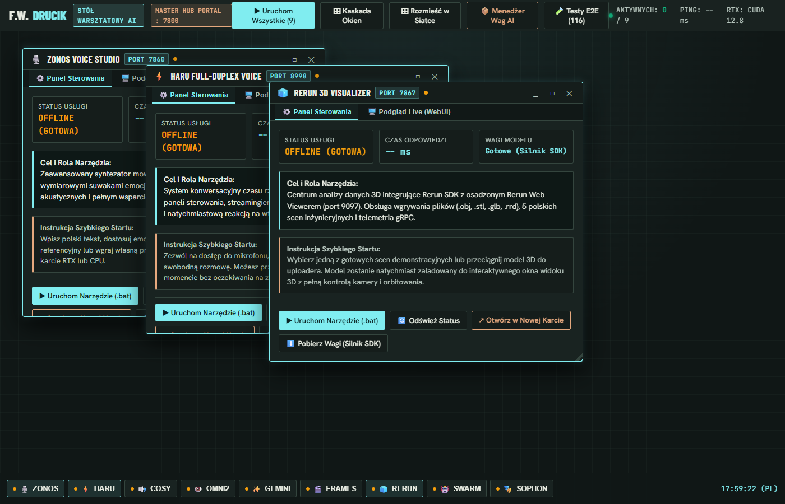
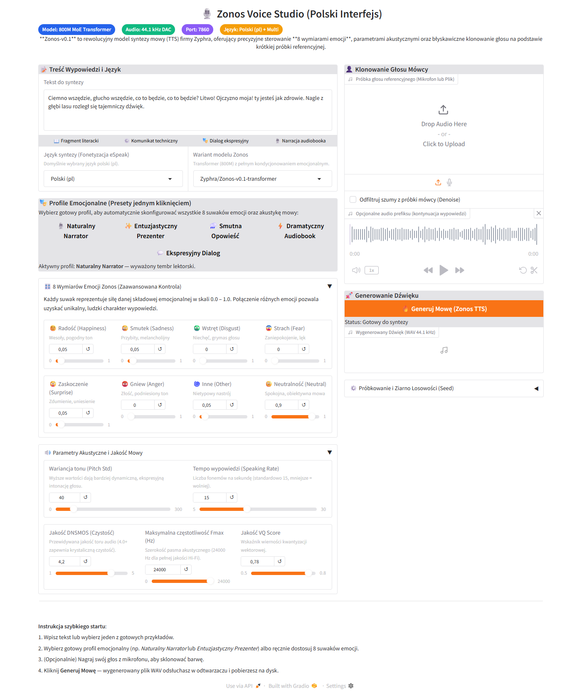
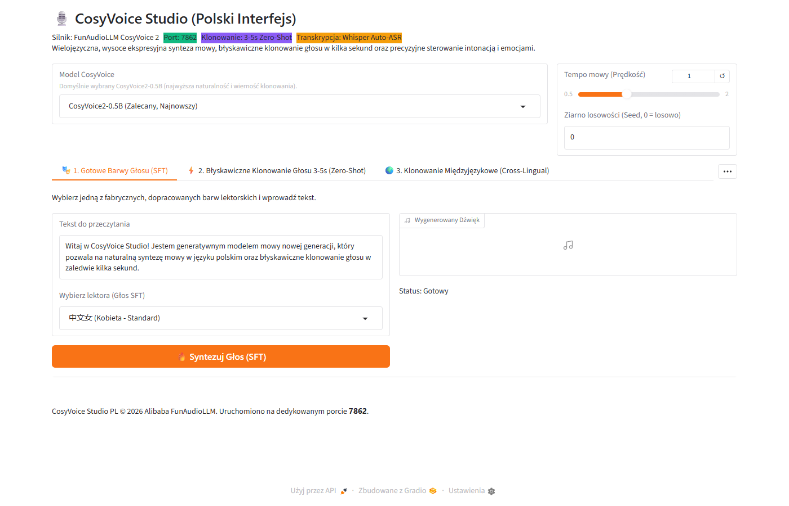
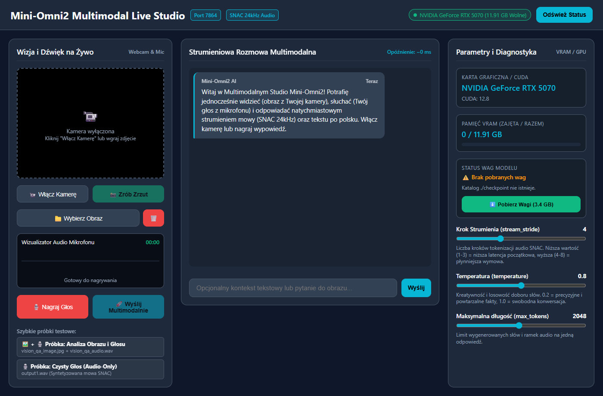
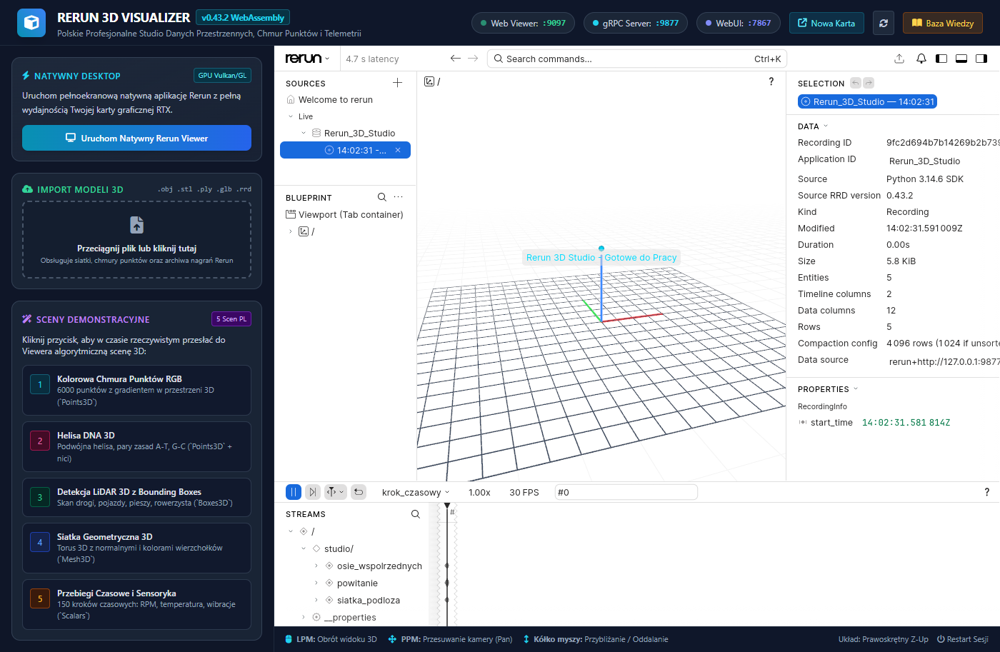
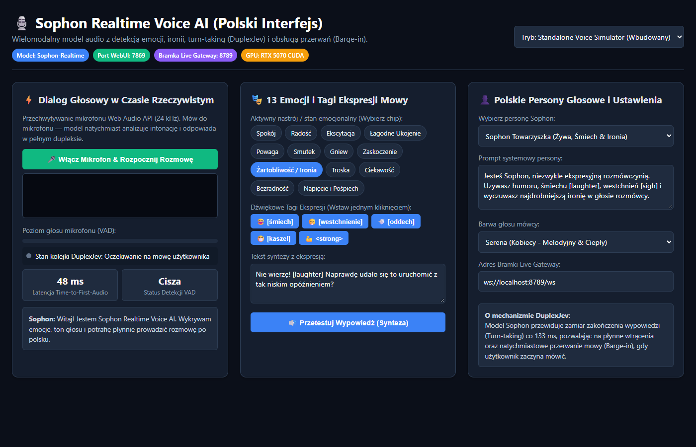

# F.W. DRUCIK — Stół Warsztatowy AI (AI-Tools Workbench Suite)

Zintegrowany ekosystem 9 desktopowych aplikacji sztucznej inteligencji zunifikowany z identyfikacją wizualną **fwdrucik.pl** oraz oparty na **technologii interaktywnych, pływających okien warsztatowych** (Workbench OS). Centralny portal **Master Hub** działa na porcie `7800` i pozwala na jednoczesną pracę z wieloma modelami AI w jednym oknie przeglądarki.

---

## 🎨 Design System F.W. DRUCIK i Technologia Okien

- **Koncepcja wizualna ("Stół Warsztatowy")**:
  - Tło pulpitu: Głęboki zielony grafit (`#101716`) z siatką techniczną stanowiska pracy.
  - Panele i karty robocze: Panel warsztatowy (`#192321`) z obramowaniem ze stali maszynowej (`#34453e`).
  - Główny sygnał akcji: Jasny cyjan warsztatowy (`#80edf0`) z poświatą neonową.
  - Akcent drugiego rzędu: Ciepła miedź / mosiądz (`#e5a87e`).
  - Tekst: Jasny papier (`#e8ece2`) i przygaszona szałwia (`#b7c6be`).
  - Typografia: `Barlow Condensed` (nagłówki i tytuły), `Hanken Grotesk` (tekst roboczy), `JetBrains Mono` (telemetria i porty).

- **Technologia Interaktywnych Okien (Workbench OS)**:
  - **Przeciąganie i układ**: Chwyć za belkę tytułową, aby swobodnie przesuwać okna po pulpicie warsztatowym.
  - **Skalowanie**: Płynna zmiana rozmiaru za prawy dolny róg okna (`resizer`).
  - **Kontrola okien**: Minimalizacja do docka (`_`), maksymalizacja na pełny ekran (`□`), zamykanie (`✕`).
  - **Tryb dwuzakładkowy**:
    - *Panel Sterowania*: Wskaźniki portu, czas odpowiedzi (ping ms), polskie instrukcje, parametry i przyciski akcji.
    - *Podgląd na Żywo (Iframe)*: Bezpośrednie osadzenie interfejsu narzędzia (WebUI) wewnątrz pływającego okna bez otwierania nowej karty.
  - **Układy automatyczne**: Przyciski szybkiego rozmieszczenia w siatce (`Tile`) oraz kaskadzie (`Cascade`).
  - **Dolny Dock Warsztatowy**: Pasek zadań z ikonami 9 narzędzi, wskaźnikami LED stanu online/offline i zegarem czasu rzeczywistego (Warszawa, PL).

---

## 📊 Tabela Portów i Narzędzi AI

| Narzędzie | Kategoria | Port | Wagi Modelu | Status Wag | Główny plik WebUI |
| :--- | :--- | :---: | :--- | :--- | :--- |
| **Master Hub Portal** | Zarządzanie | `7800` | — | Gotowe | `hub/hub_server.py` |
| **Zonos Voice Studio** | Głos i Mowa | `7860` | Zyphra Zonos-3 Mini (1.8 GB) | Pobieranie 1-click | `zonos/webui_zonos_pl.py` |
| **Haru Full-Duplex Voice** | Głos i Mowa | `8998` | Haru-4B (1.95 GB) | **Pobrane (D:\AI_Cache)** | `haru/control_center_pl.py` |
| **CosyVoice Studio** | Głos i Mowa | `7862` | CosyVoice 2 (1.5 GB) | Pobieranie 1-click | `cosyvoice/webui_cosyvoice_pl.py` |
| **Mini-Omni2 Live** | Wizja i Audio | `7864` | Mini-Omni2 (3.4 GB) | Pobieranie 1-click | `mini-omni2/webui_server.py` |
| **Gemini Omni Live Studio** | Wizja i Pulpit | `7865` | Gemini 2.5 Flash / Pro | **Gotowe (Chmura API)** | `gemini-live/webui_gemini_pl.py` |
| **Apple FastFrames AI** | Synteza Wideo | `7866` | FastFrames-S (2.1 GB) | Pobieranie 1-click | `fastframes/webui_fastframes_pl.py` |
| **Rerun 3D Visualizer** | Wizualizacja 3D | `7867` | Rerun SDK 0.43 (Natywny) | **Gotowe (Silnik 3D)** | `rerun-sdk/webui_server.py` |
| **AutoSwarm Multi-Agent** | Rój Agentów | `7868` | 6 Agentów (Framework) | **Gotowe (Orkiestrator)** | `autoswarm/webui_server.py` |
| **Sophon Realtime Voice** | Emocje i Głos | `7869` | DuplexJev (1.2 GB) | Pobieranie 1-click | `sophon-realtime/webui_server.py` |

---

## 📦 Stan Pamięci Podręcznej i Wag Modeli

Pamięć podręczna modeli znajduje się w dedykowanej lokalizacji na dysku SSD:
```
D:\AI_Cache\huggingface\hub
```
- **Gotowe od zaraz**:
  - `Haru-4B` — w pełni pobrany w `D:\AI_Cache\huggingface\hub\models--higurashi-ai--Haru-4B` (1.95 GB).
  - `Gemini Live Studio` — działa w chmurze Google GenAI API (nie wymaga lokalnych gigabajtów).
  - `Rerun 3D Visualizer` — natywny silnik C++/Rust/Python SDK (gotowe 5 scen demonstracyjnych i uploader plików CAD/STL).
  - `AutoSwarm Multi-Agent` — lokalny framework orkiestracji agentów (Codex, Claude, Hermes, Muse, Copilot).
- **Pobieranie w tle (1-Click)**:
  W nowym oknie **Menedżer Wag Modeli AI** w Master Hubie możesz jednym kliknięciem zainicjować pobieranie pozostałych modeli (Zonos, CosyVoice, Mini-Omni2, FastFrames) bezpośrednio do `D:\AI_Cache`.

---

## 📸 Galeria Zrzutów Ekranu

| Widok | Podgląd |
| :--- | :--- |
| **F.W. DRUCIK — Stół Warsztatowy (Pulpit Wielookienny)** |  |
| **Zonos Voice Studio PL** |  |
| **Haru Full-Duplex Voice PL** |  |
| **CosyVoice Studio PL** |  |
| **Mini-Omni2 Multimodal Live PL** |  |
| **Gemini Omni Live Studio PL** |  |
| **Apple FastFrames Video AI PL** |  |
| **Rerun 3D Visualizer PL** |  |
| **AutoSwarm Multi-Agent PL** |  |
| **Sophon Realtime Voice AI PL** |  |

---

## 🧪 Weryfikacja Automatyczna E2E (116 Testów)

Pakiet testów uruchamiany jest komendą:
```cmd
python tests/e2e_suite.py
```
- **Wynik**: 116/116 testów zaliczonych (**100% PASS**)
- **Błędy**: 0
- **Czas**: ~3.0 s
- **Zakres**: Kontrakty portów, brak kolizji gniazd, nagłówki CORS, poprawność AST kodu, spójność metadanych i scenariusze produkcyjne.

---

## 🚀 Uruchomienie

Uruchom Master Hub i otwórz pulpit warsztatowy pod adresem `http://localhost:7800`:
```cmd
launch_all_tools.bat --hub
```
lub kliknij skrót **`AI-Tools Master Hub.lnk`** na Pulpicie Windows.
