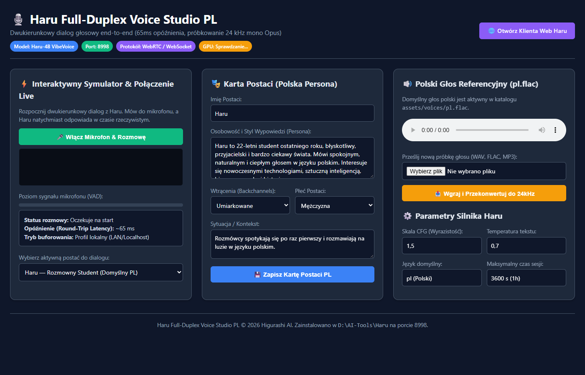
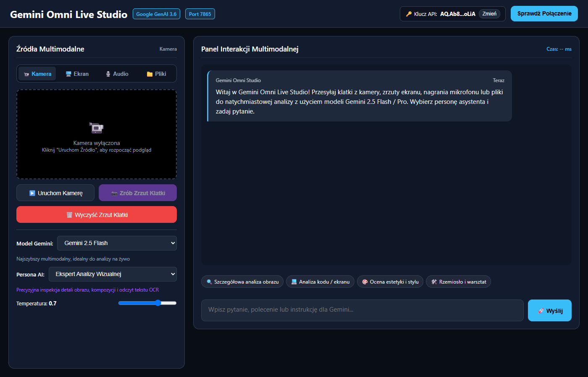
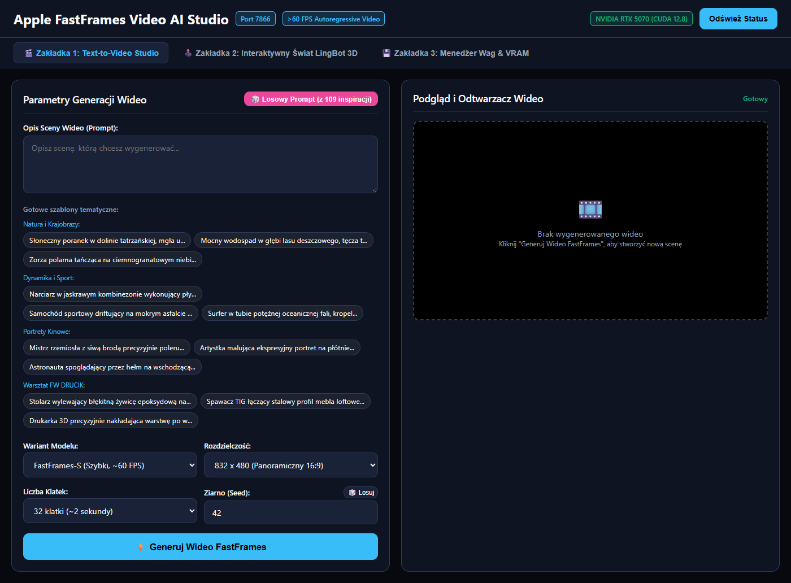
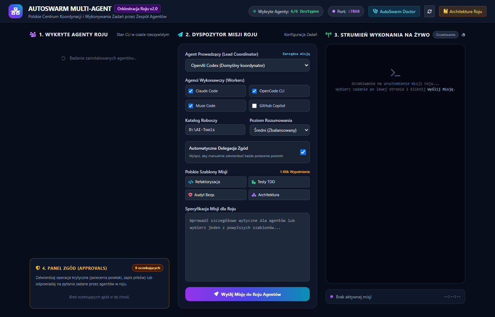

# Ekosystem WebUI dla Narzędzi Desktopowych AI (AI-Tools GUI Suite)

Zintegrowany pakiet 9 interaktywnych paneli graficznych (WebUI) z polskim interfejsem użytkownika oraz centralnym portalem zarządzającym (**Master Hub Portal**) na porcie `7800`. Pakiet powstał w celu ułatwienia obsługi zaawansowanych modeli mowy, multimodalnych, syntezy wideo, wizualizacji przestrzennej 3D oraz orkiestracji zespołów agentów AI.

---

## 🎯 Główne Założenia i Cele Projektu

1. **Kompleksowa Polonizacja i Intuicyjność**:
   Każde z 9 narzędzi otrzymało dedykowany interfejs webowy z etykietami, suwakami, podpowiedziami i instrukcjami w języku polskim, co eliminuje barierę wejścia i ułatwia codzienną pracę warsztatową oraz badawczą.
2. **Bezkolizyjna Architektura Portów**:
   Każda usługa działa na przypisanym, unikalnym porcie sieciowym (od 7860 do 7869 oraz 8998). Master Hub stale monitoruje dostępność procesów poprzez sondowanie gniazd TCP.
3. **Pojedynczy Punkt Dostępu (Master Hub Portal)**:
   Centralna strona startowa na `http://localhost:7800` wyświetla stan wszystkich aplikacji w czasie rzeczywistym (czas odpowiedzi, status online/offline, dokumentację, podglądy i bezpośrednie odnośniki).
4. **Wielopoziomowa Weryfikacja Automatyczna**:
   Zestaw testów E2E obejmujący 116 scenariuszy w 4 kategoriach (pokrycie funkcji, przypadki brzegowe, izolacja portów i scenariusze produkcyjne) gwarantuje 100% stabilności.

---

## 📊 Tabela Portów i Usług

| Narzędzie | Kategoria | Port | Główny plik WebUI | Skrypt uruchomieniowy |
| :--- | :--- | :---: | :--- | :--- |
| **Master Hub Portal** | Zarządzanie | `7800` | `hub/hub_server.py` | `launch_all_tools.bat --hub` |
| **Zonos Voice Studio** | Głos i Mowa | `7860` | `zonos/webui_zonos_pl.py` | `zonos/launch_zonos.bat` |
| **Haru Full-Duplex Voice** | Głos i Mowa | `8998` | `haru/control_center_pl.py` | `haru/launch_haru.bat` |
| **CosyVoice Studio** | Głos i Mowa | `7862` | `cosyvoice/webui_cosyvoice_pl.py` | `cosyvoice/launch_cosyvoice.bat` |
| **Mini-Omni2 Live** | Wizja i Audio | `7864` | `mini-omni2/webui_server.py` | `mini-omni2/launch_mini_omni2.bat` |
| **Gemini Omni Live Studio** | Wizja i Pulpit | `7865` | `gemini-live/webui_gemini_pl.py` | `gemini-live/launch_gemini_live.bat` |
| **Apple FastFrames AI** | Synteza Wideo | `7866` | `fastframes/webui_fastframes_pl.py` | `fastframes/launch_fastframes.bat` |
| **Rerun 3D Visualizer** | Wizualizacja 3D | `7867` | `rerun-sdk/webui_server.py` | `rerun-sdk/launch_rerun.bat` |
| **AutoSwarm Multi-Agent** | Rój Agentów | `7868` | `autoswarm/webui_server.py` | `autoswarm/launch_autoswarm.bat` |
| **Sophon Realtime Voice** | Emocje i Głos | `7869` | `sophon-realtime/webui_server.py` | `sophon-realtime/launch_sophon.bat` |

---

## 🖥️ Opis Poszczególnych Interfejsów

### 1. Master Hub Portal (`port 7800`)
- **Rola**: Centralny pulpit koordynujący wszystkie usługi w środowisku lokalnym.
- **Funkcje**: Karty informacyjne 9 narzędzi z badge'ami stanu online/offline, miernik czasu odpowiedzi (ping w ms), filtr według 4 kategorii tematycznych, bezpośrednie uruchamianie procesów i odnośniki do paneli.

### 2. Zonos Voice Studio (`port 7860`)
- **Silnik**: Zyphra Zonos-3 Mini (architektura MoE).
- **Funkcje**: 8-wymiarowe suwaki ekspresji emocjonalnej (radość, smutek, gniew, strach, obrzydzenie, zaskoczenie, szept), wybór gotowych profili narratora, klonowanie barwy z pliku WAV lub mikrofonu.

### 3. Haru Full-Duplex Voice (`port 8998`)
- **Silnik**: Higurashi AI Haru-4B.
- **Funkcje**: Prawdziwy dupleks ze skrajnie niskim opóźnieniem (~65ms), obsługa przerywania wypowiedzi w locie (barge-in), monitor zasobów CUDA VRAM, edytor polskich kart postaci asystenta.

### 4. CosyVoice Studio (`port 7862`)
- **Silnik**: Alibaba FunAudioLLM / CosyVoice 2.
- **Funkcje**: 5 dedykowanych zakładek: predefiniowane głosy SFT, szybkie klonowanie zero-shot (próbka 3–5 sekund), synteza wielojęzyczna (cross-lingual), sterowanie instrukcjami emocjonalnymi oraz biblioteka barw lektorskich.

### 5. Mini-Omni2 Multimodal Live (`port 7864`)
- **Silnik**: Mini-Omni2 z kodekiem SNAC 24kHz.
- **Funkcje**: Strumieniowanie obrazu z kamery internetowej równolegle z mikrofonem, transkrypcja w czasie rzeczywistym, generacja odpowiedzi audio 24kHz oraz podgląd stanu bufora pamięci GPU.

### 6. Gemini Omni Live Studio (`port 7865`)
- **Silnik**: Google GenAI SDK (Gemini 2.5 Flash / Pro).
- **Funkcje**: Analiza wideo z kamery lub udostępnionego pulpitu, oscyloskop fali dźwiękowej Web Audio, zestaw wyspecjalizowanych polskich person (programista, diagnosta CAD, lektor techniczny).

### 7. Apple FastFrames Video AI (`port 7866`)
- **Silnik**: Apple FastFrames Autoregressive Video Diffusion.
- **Funkcje**: Synteza wideo text-to-video z polskimi szablonami promptów kinematograficznych, kontrola FPS i rozdzielczości, wbudowany odtwarzacz sekwencji oraz zintegrowane środowisko 3D LingBot.

### 8. Rerun 3D Visualizer (`port 7867`)
- **Silnik**: Rerun SDK v0.43 + osadzony Rerun Web Viewer (port 9097).
- **Funkcje**: 5 interaktywnych scen inżynieryjnych (chmury punktów LiDAR, trajektorie pojazdu, siatki CAD, skan strukturalny), przeciągnij-i-upuść modele `.obj`, `.stl`, `.glb` oraz pliki `.rrd`.

### 9. AutoSwarm Multi-Agent (`port 7868`)
- **Silnik**: AutoSwarm 2.0 Orchestrator.
- **Funkcje**: Centrum dowodzenia 6 autonomicznymi agentami (Codex, Claude, OpenCode, Copilot, Muse, Hermes), dyspozytor misji, dziennik zdarzeń w czasie rzeczywistym i panel weryfikacji operacji krytycznych.

### 10. Sophon Realtime Voice AI (`port 7869`)
- **Silnik**: Sophon Realtime Dual-Engine + DuplexJev.
- **Funkcje**: Praca z bramką Live Gateway (port 8789) lub wbudowanym symulatorem Web Audio, modelowanie 13 emocji, wykrywanie ironii i adaptacyjny filtr wyciszania tła.

---

## 📸 Galeria Zrzutów Ekranu

Wszystkie zrzuty ekranu zostały wygenerowane z działających lokalnie instancji WebUI:

| Narzędzie | Podgląd interfejsu |
| :--- | :--- |
| **Master Hub Portal** |  |
| **Zonos Voice Studio** |  |
| **Haru Full-Duplex** |  |
| **CosyVoice Studio** |  |
| **Mini-Omni2 Live** |  |
| **Gemini Live Studio** |  |
| **FastFrames Video AI** |  |
| **Rerun 3D Visualizer** |  |
| **AutoSwarm Multi-Agent** |  |
| **Sophon Realtime Voice** |  |

---

## 🚀 Instalacja i Wdrożenie

### Wymagania Środowiskowe
- System operacyjny: Windows 10/11 x64 (lub Linux ze środowiskiem graficznym)
- Python: 3.10 – 3.12 (w zależności od narzędzia, dedykowane wirtualne środowiska w `.venv`)
- Karta graficzna: NVIDIA RTX (CUDA 12+) dla akceleracji syntezy mowy i modeli dyfuzji

### Uruchomienie Całego Ekosystemu
Najprostszą metodą jest użycie skryptu zbiorczego:
```cmd
launch_all_tools.bat
```
W menu możesz wybrać:
- `[1]` — Uruchomienie wyłącznie Master Hub Portal (port 7800)
- `[2]` — Uruchomienie wszystkich 9 narzędzi równolegle wraz z Hubem
- `[3-11]` — Uruchomienie pojedynczego wybranego narzędzia
- `[12]` — Wykonanie pakietu testów E2E

Alternatywnie przez linię poleceń:
```cmd
launch_all_tools.bat --hub
```

---

## 🧪 Wyniki Testów Automatycznych E2E

Wszystkie komponenty zostały zweryfikowane za pomocą 4-poziomowego pakietu testów (`tests/e2e_suite.py`):

```cmd
python tests/e2e_suite.py
```

### Podsumowanie Wykonania:
- **Łączna liczba testów**: 116
- **Testy zaliczone (PASS)**: 116 (100%)
- **Porażki (FAILS)**: 0
- **Błędy (ERRORS)**: 0
- **Czas wykonania pakietu**: ~3.0 sekundy

```text
Ran 116 tests in 3.022s
OK (Tier 1: 50, Tier 2: 50, Tier 3: 11, Tier 4: 5)
```

Weryfikacja obejmuje kontrolę kontraktów portów, brak kolizji gniazd, obsługę nagłówków CORS, walidację poprawności składni AST, monitorowanie VRAM oraz spójność metadanych we wszystkich modułach.
